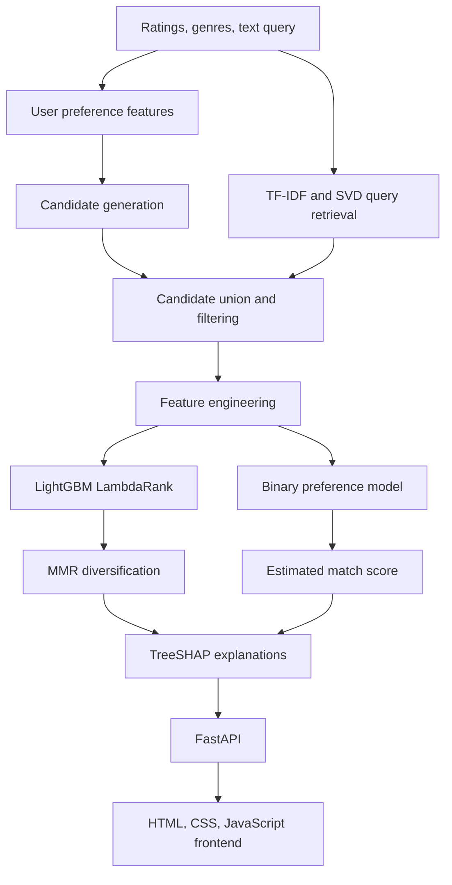

# 🎬 CineAI — Explainable Movie Recommendations

**Personalized movie recommendations with interpretable ranking, content-based retrieval, and collaborative filtering.**

CineAI is a hybrid movie recommendation system that combines user preferences, movie content, collaborative signals, and learning-to-rank to generate personalized recommendations. It also exposes feature-level explanations to make recommendations easier to understand.

Users can rate movies, select genres, explore titles, and describe the kind of film they want to watch. The project includes a Python recommendation pipeline, a FastAPI backend, and a lightweight web interface.

**Project status:** Tested prototype; public deployment coming soon.

## ✨ Features

- **Hybrid recommendations:** Combines implicit ALS collaborative filtering, content similarity, and popularity-based candidate retrieval.
- **Learning-to-rank:** Uses LightGBM LambdaRank to order candidate movies.
- **Preference estimation:** Includes a separate LightGBM classifier to estimate whether a user is likely to enjoy a movie.
- **Explainable AI:** Uses LightGBM's native TreeSHAP contributions to attribute ranking scores to model features.
- **Cold-start recommendations:** Provides genre-aware, popularity-based recommendations when a user has no rating history.
- **Mood and description search:** Matches free-text queries against movie titles, genres, and optional tags using TF-IDF and Truncated SVD.
- **Recommendation diversity:** Applies maximal marginal relevance (MMR) to reduce repetitive recommendations.
- **Temporal evaluation:** Includes chronological train, validation, and test splits, ranking metrics, and baseline comparisons.
- **Web interface:** Supports movie ratings, genre selection, recommendation cards, and expandable explanations.
- **REST API:** Exposes model functionality through FastAPI.

## 🧠 How It Works

CineAI follows a multi-stage recommendation pipeline:

1. **Understand preferences:** Collect ratings, genre preferences, and an optional text query.
2. **Generate candidates:** Retrieve candidates through collaborative filtering, content similarity, and popularity signals.
3. **Build ranking features:** Combine user statistics, movie statistics, genre affinity, release-year compatibility, and similarity scores.
4. **Rank recommendations:** Use LightGBM LambdaRank to score candidate movies.
5. **Estimate preference:** Use a separate binary classifier to estimate the probability of a positive rating.
6. **Diversify results:** Apply MMR to balance relevance and similarity among selected recommendations.
7. **Explain the ranking:** Aggregate feature-level TreeSHAP contributions into interpretable groups.
8. **Serve recommendations:** Return results through FastAPI to the browser interface.

## 🏗️ Architecture



### Core components

| Component | Purpose |
|---|---|
| Implicit ALS | Learns collaborative item representations from rating interactions. |
| TF-IDF + Truncated SVD | Represents movie metadata and text queries in a compact content space. |
| Ridge regression | Helps estimate collaborative factors for less frequently rated items from content representations. |
| LightGBM LambdaRank | Learns how to order retrieved candidate movies. |
| Binary LightGBM classifier | Estimates the likelihood of a positive user rating. |
| TreeSHAP contributions | Explains the ranking model through individual feature contributions. |
| Maximal Marginal Relevance | Improves diversity within the final recommendation list. |
| FastAPI | Exposes recommendation, search, onboarding, genre metadata, and health-check endpoints. |

## 🔍 Explainable AI

CineAI organizes feature contributions into five groups:

- **Your genre taste:** Genre affinity and genre overlap.
- **Similar to what you liked:** Content-based similarity signals.
- **People with similar taste:** Collaborative-filtering signals.
- **Community rating:** Rating statistics and popularity features.
- **Era & profile fit:** User history and release-year features.

The recommendation backend obtains feature contributions through LightGBM's native `pred_contrib=True` interface and aggregates them into these groups. The notebook also includes optional global explanation plots using the SHAP library.

**Important:** In the trained-model path, explanations are derived from model contributions. The frontend's demo mode instead uses sample recommendations and predefined explanations.

## 🛠️ Tech Stack

**Language:** Python

**Machine Learning:** LightGBM, implicit ALS, scikit-learn, TF-IDF, Truncated SVD, Ridge regression

**Data Processing:** NumPy, pandas, SciPy sparse matrices

**Explainability:** LightGBM feature contributions, SHAP visualizations

**Backend:** FastAPI, Pydantic, Uvicorn

**Frontend:** HTML, CSS, JavaScript

**Training Environment:** Google Colab and Google Drive

## 📁 Repository Structure

```text
CineAI/
├── README.md
├── cineai.py
├── app.py
├── cineai_widget.html
└── CineAI_v2_colab.ipynb
```

- `cineai.py` — Recommendation models, candidate generation, ranking, explanations, and evaluation utilities.
- `app.py` — FastAPI endpoints and model-loading entry point.
- `cineai_widget.html` — Browser-based interface.
- `CineAI_v2_colab.ipynb` — Training, evaluation, visualization, and API-launch workflow.

## 📊 Dataset

The training notebook is configured for **MovieLens 32M** from GroupLens.

Dataset: https://grouplens.org/datasets/movielens/32m/

The notebook uses:

- `ratings.csv` for user–movie rating interactions.
- `movies.csv` for movie titles, genres, and years.
- `tags.csv` for additional movie-content features.

Download and extract the dataset before running the notebook.

Expected Google Drive layout:

```text
MyDrive/CineAI/
├── code/
│   ├── cineai.py
│   └── app.py
├── ml-32m/
│   └── ml-32m/
│       ├── ratings.csv
│       ├── movies.csv
│       └── tags.csv
└── Artifact_v2/
```

The notebook creates the artifact directory when training begins.

## 🚀 Run the Training Pipeline

The supplied notebook is designed for Google Colab and uses checkpoints to preserve the trained base model.

1. Place `cineai.py` and `app.py` in `MyDrive/CineAI/code/`.
2. Download MovieLens 32M and place its CSV files in the expected directory.
3. Open `CineAI_v2_colab.ipynb` in Google Colab.
4. Execute the cells in order to prepare the data, train the base models, fit the ranking and preference models, evaluate recommendations, and generate explanation plots.
5. The notebook saves the full model as `Artifact_v2/rs_full.pkl` and the base checkpoint as `Artifact_v2/rs_base.pkl`.

Training time depends on the runtime and configuration. The notebook is designed to reuse the base checkpoint when available.

## ⚙️ Run the API Locally

A trained model artifact is required for live recommendations.

Install the dependencies:

```bash
pip install numpy pandas scipy scikit-learn joblib implicit lightgbm fastapi uvicorn
```

From the project directory, configure the model path.

**macOS / Linux**

```bash
export CINEAI_MODEL="/absolute/path/to/rs_full.pkl"
uvicorn app:app --host 127.0.0.1 --port 8000
```

**Windows PowerShell**

```powershell
$env:CINEAI_MODEL = "C:\path\to\rs_full.pkl"
uvicorn app:app --host 127.0.0.1 --port 8000
```

Verify the API:

```bash
curl http://127.0.0.1:8000/health
```

Other available endpoints include:

| Method | Endpoint | Description |
|---|---|---|
| GET | `/health` | Health check and catalogue size. |
| GET | `/meta` | Available genres. |
| GET | `/onboarding?n=12` | Movies used for initial preference collection. |
| GET | `/search?q=space%20thriller&n=12` | Content-based movie search. |
| POST | `/recommend` | Recommendations from rating history and preferences. |

### Example recommendation request

```bash
curl -X POST "http://127.0.0.1:8000/recommend" \
  -H "Content-Type: application/json" \
  -d '{
    "history": [
      {"movieId": 2571, "rating": 5.0},
      {"movieId": 1, "rating": 4.0}
    ],
    "genres": ["Sci-Fi", "Drama"],
    "query": "a thoughtful, slow-burn science-fiction film",
    "top_n": 12
  }'
```

The movie IDs must exist in the trained model's catalogue. An empty rating history is accepted for the cold-start path.

## 📈 Evaluation Methodology

The notebook uses a per-user chronological split:

| Split | Share of each user's interactions |
|---|---:|
| Training | Oldest 75% |
| Validation | Next 10% |
| Test | Newest 15% |

This design aims to evaluate recommendations against later interactions instead of randomly mixing the user's past and future ratings.

The implementation includes:

- **Precision@K:** Fraction of the top-K recommendations that are relevant.
- **Recall@K:** Fraction of relevant items retrieved.
- **NDCG@K:** Position-sensitive ranking quality.
- **Hit rate:** Fraction of evaluated users receiving at least one relevant item.
- **Catalogue coverage:** Share of the catalogue appearing in recommendation lists.
- **Novelty and genre diversity:** Additional measures of discovery and variety.
- **Cold-start evaluation:** Simulates users with 0, 1, 3, 5, 10, or 20 available ratings.
- **Baseline comparisons:** Compares recommendation signals against ALS, popularity, and a user/item-mean baseline where applicable.

The evaluation code also examines preference-confidence thresholds and the associated precision/coverage trade-off.

### Results

The notebook contains the evaluation routines, but published benchmark values should come from the actual completed run.

Before reporting numerical claims, record the measured results, dataset version, evaluation configuration, and runtime. Do not substitute assumed values for measured Precision@K, Recall@K, NDCG, or latency.

## 🌐 Deployment Status

**Public demo: Coming soon.**

The current frontend can communicate with the FastAPI service through a configured API URL. For deployment:

- Replace the temporary Cloudflare tunnel URL with the deployed API origin.
- Restrict CORS to the actual frontend domain.
- Keep model artifacts and datasets separate from the source repository.
- Verify the complete user flow against the deployed model.
- Document the public demo URL here after deployment.

The interface currently stores ratings in browser `localStorage`; this is not a cloud-synced user profile.

## ⚠️ Limitations and Future Work

CineAI is a tested portfolio prototype, not yet a production-grade recommendation service.

Potential improvements include:

- Evaluate transformer-based text embeddings against the current TF-IDF/SVD search baseline.
- Improve query-conditioned recommendations for users with no rating history.
- Add automated unit and API integration tests.
- Pin dependency versions and provide a reproducible installation file.
- Publish measured offline metrics and representative explanation plots.
- Configure production CORS, stable hosting, logging, monitoring, and error handling.
- Add persistent user profiles if multi-device personalization is required.

## 📚 References

- [GroupLens Research — MovieLens 32M](https://grouplens.org/datasets/movielens/32m/)
- [LightGBM Documentation](https://lightgbm.readthedocs.io/)
- [implicit Documentation](https://implicit.readthedocs.io/)
- [FastAPI Documentation](https://fastapi.tiangolo.com/)
- [scikit-learn Documentation](https://scikit-learn.org/)

---

**CineAI — recommendations with a reason.**
